<h1 align="center">Hey  I'm Zeeshaan Ebrahim</h1>

## 📌 About Me
<em> Software developer, Data Scientist, Web developer, ML Engineer. I am multi faceted and have dipped my toes in many fields. In short, I get things done.
I completed my undergraduate degree at UCT in Computer Science and Computer Engineering, dealing with everything from applications of algorithms to embedded systems. I also completed my Honours degree at Wits in Computer Science focusing on AI and ML with some work in the cybersecurity and robotics space as well as data science. 
</em>

## 📊 GitHub Stats & Trophies

  
  

  

  

  

## 🛠️ Languages & Tools
> ## Programming Languages

 Also: SQL · Assembly

> ## Web & Backend

 Django REST Framework · REST API design · authentication

> ## AI & Machine Learning

 Stable-Baselines3 · MuJoCo · reinforcement learning · experiment design

> ## Databases

 Microsoft SQL Server · schema design · versioned migrations

> ## Cloud & Tools

  AWS S3 · Docker Compose · Linux/WSL · pytest · JUnit · Agile/Scrum

## 🚀 Projects
- **Mo Pro Sound** · production e-commerce platform for a paying client. Built solo: design, database, backend, authentication and deployment. Live since May 2026 with 100+ products. *Next.js, TypeScript, PostgreSQL, Supabase*
- **[Joe's Auto](https://joesautovaal.co.za)** · dealership inventory and sales-lead platform (in progress). Photo uploads go straight to AWS S3 via presigned URLs, and the admin area sits behind session authentication. *TypeScript, PostgreSQL, AWS S3, Docker Compose*
- **[RoboChessGymnasium](https://github.com/ZeeshaanEbrahim/robochess_gymnasium)** · Honours research at Wits: a training environment where a simulated robot arm learns five manipulation tasks, with one-command experiments across 200+ runs. *Python, PyTorch, Stable-Baselines3, MuJoCo*
- **Interactive Byte Pair Encoding Tokenizer** · full-stack tool that makes subword tokenisation steppable and inspectable. *Python, Django REST Framework, React*
- **Hotel Booking Management System** · four-person UCT team project; I owned the relational schema and booking logic. *C#, .NET, Microsoft SQL Server*

## 🎓 Education & Leadership
- **B.Sc. Honours, Computer Science** · University of the Witwatersrand, 2026. Machine Learning, AI, Reinforcement Learning, Cybersecurity, Research Methods.
- **B.Sc., Computer Science & Computer Engineering** · University of Cape Town, 2022 – 2025.
- **Mentor and Fellow** · Absa Fellowship Leadership Programme, 2022 – present. Mentoring six junior fellows.
- **Project Manager, Software Development Teams** · UCT, Aug – Oct 2024. Ran Agile sprints and code review across several teams.

## 🔗 Connect with Me

  

