<h1 align="center">Hey  I'm Zeeshaan Ebrahim</h1>

## 📌 About Me
<em> Software developer, Data Scientist, Web developer, ML Engineer. I am multi faceted and have dipped my toes in many fields. In short, I get things done.
I completed my undergraduate degree at UCT in Computer Science and Computer Engineering, dealing with everything from applications of algorithms to embedded systems. I also completed my Honours degree at Wits in Computer Science focusing on AI and ML with some work in the cybersecurity and robotics space as well as data science. 
</em>

## 📊 GitHub Stats & Trophies

  
  

  

  

  

## 🛠️ Languages & Tools
> ## Programming Languages

    

> ## Tools

  

## 🔗 Connect with Me

<!-- Add LinkedIn / email icons here, e.g. <a href="https://www.linkedin.com/in/YOUR-HANDLE"> -->
 <a href="https://www.linkedin.com/in/zeeshaan-ebrahim">

